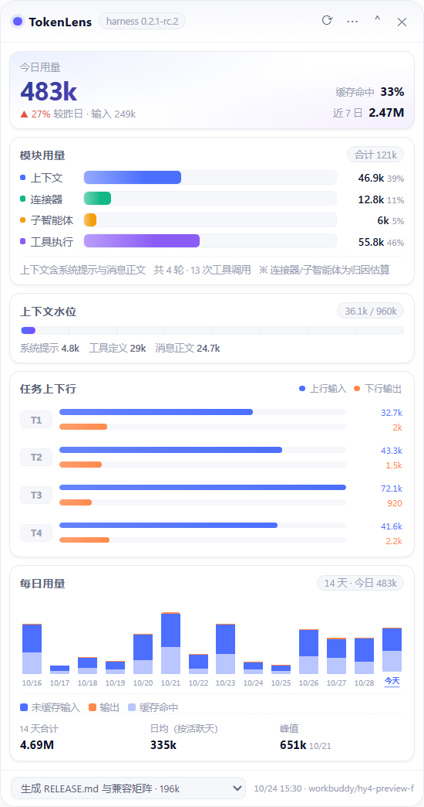

# TokenLens · Token 用量浮窗

> 贴在桌面上的「用量仪表」：DeepSeek Harness 与 WorkBuddy 的 token 消耗，按模块、按模型、按轮次、按天，一眼看完。纯本地、零上传。

[](https://github.com/linusxch/tokenlens/releases)
[](LICENSE)




## 它解决什么问题

用量数字平时藏在会话状态里，要点开、翻页、心算。TokenLens 把它们抠出来做成一个**永远置顶的小窗**，并且支持两个数据源：

**Harness 视图**（`~/.dsh`）

- **模块归因**：上下文、连接器、子智能体、工具执行各占多少、几成
- **任务上下行**：第几轮、上行输入多少、下行输出多少
- **上下文水位**：surface 占上下文窗口的百分比 + 系统／工具／消息三分拆
- **每日统计**：14 天堆叠柱（未缓存输入／输出／缓存命中）+ 合计、日均、峰值

**WorkBuddy 视图**（`~/.workbuddy`）

- **模型用量**：按模型汇总 token 与占比，含请求次数、平均每次、缓存命中率
- **请求画像**：整体缓存命中率、平均每次开销、推理输出、平台计量
- **会话明细**：每个会话的总量、主导模型、请求数、最后活跃时间
- **每日统计**：同一套 14 天图表

三种打开形态：

| 形态 | 命令 | 说明 |
| --- | --- | --- |
| 浮窗 | `npm start` | 无边框、置顶、可拖拽缩放的独立窗口 |
| 紧凑条 | 点标题栏 `⌃` | 收成一条 48px 横条，托盘/快捷键随时展开 |
| 面板 | `npm run panel` | 起一个本地 HTTP 面板，可嵌进 harness web profile 或任意 iframe |

## 快速开始

```bash
# 1) 环境自检（两个数据源都会检查）
node scripts/doctor.js

# 2) 启动浮窗（默认 Harness 视图）
npm start

# 3) 直接以 WorkBuddy 视图启动
npm start -- --source=workbuddy

# 4) 数据太少？先看示例面板
npm run demo
```

`npm start` 会按顺序找一个能用的 Electron 运行时：

1. `TOKENLENS_ELECTRON` 环境变量指定的路径
2. 项目内 `node_modules/electron`
3. **DeepSeek Harness 自带的 Electron**（装了 harness 就不用再下载）
4. `PATH` 上的 `electron`

机器上装了 Harness，就**不需要 `npm install`**。

## 切换数据源

| 方式 | 操作 |
| --- | --- |
| 菜单 | `⋯` → 数据源 → Harness / WorkBuddy / 示例 |
| 快捷键 | `Ctrl + Tab` 循环切换 |
| 托盘 | 右键 → 数据源 |
| 启动参数 | `--source=harness\|workbuddy\|demo` |

选择会被记住（`%APPDATA%\tokenlens\config.json`），下次启动直接进入。

## 快捷键与托盘

| 操作 | 方式 |
| --- | --- |
| 显示 / 隐藏浮窗 | `Ctrl + Alt + T`，或点托盘图标 |
| 立即刷新 | 标题栏 `⟳`，或 `Ctrl + R` |
| 折叠 / 展开 | 标题栏 `⌃` / 紧凑条 `⌄` |
| 切换数据源 | `Ctrl + Tab` |
| 刷新间隔 | `⋯` → 2s / 5s / 15s / 暂停 |
| 置顶开关 | `⋯` → 窗口 → 置顶 / 普通 |
| 会话切换（Harness） | 底部下拉框 |
| 开机自启 / 任务栏显示 / 打开数据目录 | 托盘右键菜单 |

## 数据从哪来

全部读取本地文件，**不发任何网络请求**。

### Harness

| 来源 | 路径 | 用途 | 口径 |
| --- | --- | --- | --- |
| 会话投影缓存 | `~/.dsh/storages/session_projcache/sessions/session-*.json` | 会话标题、模型、总用量、上下文拆分 | **准数** |
| 会话事件流 | `~/.dsh/sessions/<project>/<session>/session.v4.jsonl.zstd` | 逐轮用量、工具调用、时间戳 | **准数** |
| 每日历史库 | `%APPDATA%\tokenlens\history.json` | 跨天累积 | 由上面两者按天汇总 |

事件流是**追加写**的 zstd 多帧文件，每段 append 都是一个独立 frame。
Node 的 `zlib.zstdDecompressSync` 只解第一帧，直接读会丢九成数据——
TokenLens 按 zstd magic 扫描逐帧解压，这是能还原逐轮明细的关键。

### WorkBuddy

| 来源 | 路径 | 用途 |
| --- | --- | --- |
| 会话事件流 | `~/.workbuddy/projects/<project>/<session-id>.jsonl` | 每次模型调用的用量、模型名、时间戳 |
| 会话标题 | 同上（`ai-title` 记录） | 会话列表展示 |
| 每日历史库 | `%APPDATA%\tokenlens\history-workbuddy.json` | 跨天累积（独立于 Harness） |

每条记录里的 `providerData` 提供：

- `usage` / `rawUsage` —— `inputTokens`（**已含缓存**）、`outputTokens`、`prompt_cache_hit_tokens`、`prompt_cache_miss_tokens`、`reasoning_tokens`、`credit`
- `model` / `requestModelId` / `requestModelName` —— 模型信息

同一条消息可能同时出现在 `function_call` 与 `message` 记录里，按 `messageId` 去重。
同一模型的大小写写法（`Deepseek-V4.1-Flash` / `DeepSeek-V4.1-Flash`）会合并，展示名取出现最多的那种。

解析结果按 `(mtime, size)` 缓存：十几 MB 的会话首次解析约 150ms，之后每次刷新约 8ms。

### 准数 vs 估算

- **Harness 的总量／逐轮／上下文** —— 准数，harness 自己记录的。
- **Harness 的模块归因** —— 连接器／子智能体／工具执行是**估算**（harness 不记录单次工具结果占多少 token），UI 上用 `※` 标注。
- **WorkBuddy 的全部用量** —— 准数，来自平台返回的 usage 字段；`credit`（平台计量）只展示，不做金额换算。

## 兼容性

Harness 侧对着 **DeepSeek Harness Desktop 0.2.1-rc.2 / 会话格式 v4** 开发验证；
WorkBuddy 侧对着本机 `~/.workbuddy/projects` 的 jsonl 结构（2026-10 版本）验证。

| 项目 | 要求 |
| --- | --- |
| 系统 | Windows 10 / 11（x64）。macOS / Linux 逻辑上可跑，未验证 |
| Node | ≥ 22.15（需要 zstd API）。低于此版本仅 Harness 明细降级，WorkBuddy 不受影响 |
| Electron | 建议 30+；本机实测 harness 自带 43.3.0（Node 24.18.1） |
| Harness | 0.2.x（session format v4） |
| WorkBuddy | jsonl 含 `providerData.usage`；字段缺失时自动跳过该条记录 |

读取逻辑对未知事件类型、缺失字段、半写文件一律容错跳过，小版本升级不会崩，最坏情况是某些面板降级为空。

## 已知限制

- WorkBuddy 不暴露上下文窗口大小，因此没有「上下文水位」；也没有模块归因，用「模型用量」替代。
- WorkBuddy 里没有用量记录的会话（纯对话、无模型调用）不参与统计，`doctor` 会提示数量。
- 会话标题偶有占位词，面板会退回首条消息或目录名。
- 只读，不修改任何源数据；不做成本换算。

## 开发者

```
src/
  main/
    main.js          主进程：浮窗、托盘、快捷键、IPC、数据源切换
    collector.js     Harness 采集器：projcache + zstd 多帧事件流
    workbuddy.js     WorkBuddy 采集器：projects/*.jsonl（带 mtime 缓存）
    history.js       每日历史库（按天取大值，重复采集不翻倍）
    service.js       视图模型：双数据源调度、模块/模型聚合
    demo.js          示例数据（固定种子，刷新不跳变）
    panel-server.js  面板模式 HTTP 服务（仅监听 127.0.0.1）
  preload/preload.js 最小 IPC 面（contextIsolation 开启，无 Node 直通）
  renderer/          纯 CSS/DOM 图表，无前端框架、无 CDN；双视图共用一套样式
scripts/
  start.js           运行时探测 + 启动
  serve.js           无 Electron 的面板模式（--source 可选）
  doctor.js          环境自检（两个数据源）
  make-icon.js       图标生成（纯 Node 写 PNG）
  pack.js            打包 zip（纯 Node 写 ZIP）
```

常用命令：

```bash
node scripts/doctor.js                 # 数据链路是否通
npm start -- --dev                     # 开 DevTools
npm start -- --shot=out.png            # 截图自测（自动关硬件加速）
npm start -- --source=workbuddy        # 指定数据源启动
npm run panel                          # 面板模式 http://127.0.0.1:4317
npm run panel -- --source=workbuddy    # 面板模式 + WorkBuddy 数据
npm run pack                           # 产出 dist/tokenlens-<version>.zip
```

## 隐私

- 只读 `~/.dsh` 与 `~/.workbuddy` 下的会话文件，写 `%APPDATA%\tokenlens` 下的配置与历史库。
- 无遥测、无网络请求、无账号。
- 面板模式只绑定 `127.0.0.1`。

## License

MIT © 2026 柒仔
