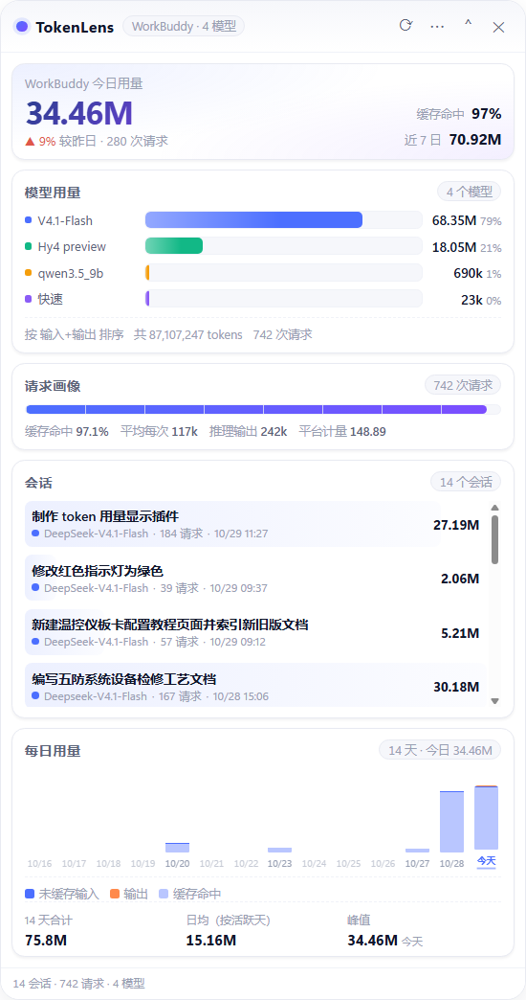

# Release Notes

## v1.1.1 — 2026-10-29

打包出**可直接双击运行的 Windows 免安装版**。前面两个版本都要求机器上有 Node / Electron，这一版把运行时一起带上。

### 新增

**Windows 免安装包（portable）**

- 产物：`TokenLens-1.1.1-win64-portable.zip`（128.8 MB），解压后双击 `TokenLens.exe` 即可，
  不依赖 Node、npm、harness，也不用联网。
- 新增 `scripts/build-win.js`，做法是复用本机已有的 Electron 运行时拼出应用目录：
  - 拷运行时骨架 → 应用文件放进 `resources/app` → 主程序改名 `TokenLens.exe`
  - 裁掉 53 个多余语言包（只留 `en-US` / `zh-CN`）：348 MB → 302 MB
  - 用 `resedit`（纯 JS，无需原生二进制）改写 PE 资源：图标（16–256 七档 ICO）+ 版本信息
    （ProductName `TokenLens` / FileVersion `1.1.1` / CompanyName `柒仔` / OriginalFilename `TokenLens.exe`）
  - 自写 ZIP 写入器（deflate + CRC32），主程序压缩率 44%（215 MB → 94 MB）
- `scripts/make-icon.js` 现在额外产出多尺寸 `assets/icon.ico`（内嵌 PNG，Vista+ 规范）。
- 新增 npm 脚本：`npm run build:win`。
- 未做代码签名，首次启动可能被 SmartScreen 拦一次（更多信息 → 仍要运行）。

### 校验

- SHA256 `4948a91e1b24563aa9e357df1ff49916e5e2ec284f57dc48df08116f70629d5d`
- 解压后 41 个文件、302 MB；`TokenLens.exe` 215 MB

### 验证

- 直接运行 `dist/TokenLens-win64/TokenLens.exe` → 两套视图正常渲染
- 把 zip 解压到独立目录再运行 → 同样正常（验证不依赖项目目录）
- `unzip` 后 CRC32 全量校验通过（41 个文件）

---

## v1.1.0 — 2026-10-29

新增 **WorkBuddy 数据源**：同一个浮窗里现在能看两套账 —— Harness 的模块归因，和 WorkBuddy 的**按模型**消耗。



### 新增

**WorkBuddy 视图（按模型看用量）**

- 数据来源：`~/.workbuddy/projects/<project>/<session-id>.jsonl`，取每条记录的 `providerData.usage` / `rawUsage`。
- **模型用量**：按模型汇总 token 与占比，附带请求次数、平均每次开销、缓存命中率；tooltip 里给出未缓存输入 / 缓存命中 / 输出 / 推理输出的完整拆分。
- **请求画像**：整体缓存命中率条 + 平均每次 / 推理输出 / 平台计量（credit）。
- **会话明细**：每个会话的总量、主导模型、请求数、最后活跃时间，按用量排布背景条。
- **每日统计**：与 Harness 共用的 14 天堆叠柱。
- 模型名归并：`Deepseek-V4.1-Flash` 与 `DeepSeek-V4.1-Flash` 合并为一个模型，展示名取出现最多的写法，tooltip 里列出全部别名。

**数据源切换（四种入口）**

- 菜单 `⋯` → 数据源 → Harness / WorkBuddy / 示例
- 快捷键 `Ctrl + Tab` 循环切换
- 托盘右键 → 数据源（带 radio 勾选，切换后浮窗即时跟随）
- 启动参数 `--source=harness|workbuddy|demo`

选择持久化到 `%APPDATA%\tokenlens\config.json`，下次启动直接进入；面板模式支持 `?source=workbuddy`。

**口径与工程细节**

- WorkBuddy 的 `usage.inputTokens` 与 `rawUsage.prompt_tokens` **已包含缓存命中部分**；未缓存输入取 `prompt_cache_miss_tokens`，缺失时用 `input − hit` 兜底。
- 同一条消息可能同时出现在 `function_call` 与 `message` 记录里，按 `providerData.messageId` 去重（实测 710 条 usage 记录零重复）。
- 两个数据源各自维护每日历史库（`history.json` / `history-workbuddy.json`），互不污染。
- WorkBuddy 侧有精确的按日归属，因此**不做** Harness 那套「首见归总到创建日」的外推，避免多天会话把某一天抬高。
- 解析结果按 `(mtime, size)` 缓存：11 MB / 18 个会话首次 147ms，命中缓存后 8ms。
- `scripts/doctor.js` 增加 WorkBuddy 段（会话数、请求数、总量、模型列表、无用量会话提示）。

### 本机实测（首次跑通时的快照）

| 指标 | 数值 |
| --- | --- |
| 会话 | 14 个有用量 / 共 18 个 jsonl |
| 请求 | 714 次 |
| 总 tokens | 80,443,766（未缓存 2,468,659 / 缓存 77,486,720 / 输出 488,387） |
| 缓存命中率 | 96.9% |
| 模型 | DeepSeek-V4.1-Flash(475) · Hy4 preview(221) · qwen3.5_9b(17) · 快速(1) |

### 兼容性

| 项目 | 说明 |
| --- | --- |
| WorkBuddy jsonl | 含 `providerData.usage`；缺字段的记录自动跳过，不报错 |
| Harness | 仍为 0.2.1-rc.2 / session format v4，读取逻辑未改动 |
| Node | WorkBuddy 侧不依赖 zstd，Node 18 也能跑；Harness 明细仍需 ≥ 22.15 |

### 已知限制

- WorkBuddy 不暴露上下文窗口，因此该视图没有「上下文水位」，也没有模块归因。
- 4 个会话在本地没有用量记录（纯对话），不计入统计，仅在 `doctor` 里提示。
- `credit`（平台计量）只展示原始数值，不做金额或单价换算。

---

## v1.0.0 — 2026-10-29

首个可发布版本。目标很朴素：把 DeepSeek Harness 已经算好的 token 账，变成一个**贴桌面、看得懂、不打扰**的浮窗。

---

### 新增

**浮窗形态（Windows）**

- 无边框、置顶、透明圆角的独立窗口，默认贴在屏幕右侧中部，可拖拽、可缩放，位置自动记忆。
- 托盘常驻：显示/隐藏、置顶开关、打开数据目录、浏览器打开面板、开机自启、任务栏开关、退出。
- 全局快捷键 `Ctrl + Alt + T` 随时呼出/收起；`Ctrl + R` 立即刷新。
- 紧凑模式：一键收成 52px 高的横条，只留今日总量与缓存命中率。
- 关闭窗口默认收进托盘而不是退出（托盘菜单里可退出）。

**四块核心读数**

| 面板 | 内容 |
| --- | --- |
| 今日概览 | 今日总量（大字）+ 环比昨日、缓存命中率、近 7 日累计 |
| 模块用量 | 上下文 / 连接器 / 子智能体 / 工具执行 四条横条，含 token 数、占比、调用次数 |
| 上下文水位 | surface 占上下文窗口百分比 + 系统提示/工具定义/消息正文三分拆 |
| 任务上下行 | 每一轮两行条：上行输入（蓝）、下行输出（橙），共用平方根标尺 |
| 每日用量 | 最近 14 天堆叠柱（未缓存输入/输出/缓存命中）+ 合计、日均、峰值 |

**数据层**

- 直读 harness 投影缓存（`session_projcache`）拿官方口径总量与上下文拆分。
- 自研 **zstd 多帧扫描解压**，还原 `session.v4.jsonl.zstd` 里被追加写分散在数十个 frame 的完整事件流；这是逐轮明细、工具调用、每日统计能对上的前提。
- 逐轮用量取 `assistant/message.data.usage`，实测累计值与 `tokenUsage.totals` **逐 token 完全一致**（本机样本：268,723 / 4,578 / 144,192）。
- 每日历史库：按天单调合并，重复采集不翻倍；会话被清理后历史仍在。
- 估算与准数严格区分：工具 schema / 工具返回这类 harness 不给 token 数的部分用 CJK 感知估算，UI 上带 `※` 标注，不冒充准数。

**工程**

- 零前端依赖：图表用纯 DOM + CSS（无 Canvas 库、无 CDN），断网可用。
- 零安装启动：自动探测 Electron 运行时，优先复用 **harness 自带的 Electron**，装了 harness 就不必 `npm install`。
- 面板模式：`npm run panel` 在没有 Electron 的环境起本地 HTTP 面板（仅绑 127.0.0.1），可嵌 iframe。
- 安全基线：`contextIsolation` 开启、`nodeIntegration` 关闭、preload 只暴露最小 IPC 面、CSP 已配置。
- 自检与打包：`scripts/doctor.js` 输出环境/会话/每日明细；`scripts/pack.js` 纯 Node 生成 zip。
- 图标、打包均由纯 Node 手写 PNG / ZIP 生成，不引入图形或压缩依赖。

---

### 兼容性

验证环境：

| 项目 | 版本 |
| --- | --- |
| DeepSeek Harness Desktop | **0.2.1-rc.2** |
| 会话事件格式 | **v4**（`session.v4.jsonl.zstd`） |
| 投影缓存格式 | record v7 / rows v2–v6 |
| Electron（实测） | 43.3.0（Node 24.18.1，Chromium 150） |
| Node（面板模式） | 22.22.2 |
| 系统 | Windows 11 x64 |

| harness 版本 | 状态 |
| --- | --- |
| 0.2.1-rc.2 | ✅ 已验证 |
| 0.2.x 其它小版本 | ⚠️ 预期可用（解析器对未知字段/事件容错），未逐一验证 |
| 0.1.x / session format < v4 | ❌ 未适配 |

降级策略：若运行时 Node < 22.15（无 `zlib.zstdDecompressSync`），浮窗仍可打开，但只显示会话级准数，逐轮与每日统计为空，并在 `warnings` 里说明原因。`node scripts/doctor.js` 会直接告诉你 zstd 是否可用。

---

### 口径说明（重要）

1. **总量/逐轮/上下文 = 准数**，来自 harness 自身记录。
2. **连接器/子智能体/工具执行 = 归因估算**，因为 harness 不记录「某个工具结果占了多少 token」。
   估算基于字符数（中文 ≈1.5 字/token，拉丁 ≈3.5 字/token），量级可信、绝对值有误差。
3. **工具 schema 归属规则**：模块被真正调用时，其 schema 计入该模块；未被调用则回流到「上下文」。
   所以没用过连接器的会话，「连接器」显示 `—` 而不是一个凭空的 schema 数字。
4. **每日统计**按「轮次结束时间」的本地日期归日；早年会话首次被发现时归到会话创建当天，不会全堆到今天。
5. **空会话**（只有缓存、没有事件流）不参与轮次与日统计，只贡献总量。

---

### 已知限制

- 只读、不能改 harness 的任何数据；也不做成本换算（单价随模型/套餐变化，不做内置假设）。
- 会话列表未做搜索/置顶，会话多了靠下拉框翻。
- 仅 Windows 深度验证；托盘图标在 macOS 上未做模板图适配。
- 面板模式固定端口 4317，占用时需改 `--port`（浮窗内「在浏览器中打开面板」会失败但主功能不受影响）。
- 子智能体若运行在**独立 session**（`delegationDepth > 0`），其用量会计入该子会话而非父会话的「子智能体」模块；当前样本未覆盖该场景，逻辑已按此实现但缺实测。

---

### 升级/安装

```bash
# 解压 tokenlens-1.0.0.zip 后
node scripts/doctor.js   # 先确认数据链路
npm start                # 起浮窗（无需 npm install，自动复用 harness 的 Electron）
```

配置与历史库位置：`%APPDATA%\tokenlens\`（`config.json` / `history.json`）。
升级直接覆盖程序文件即可，历史库向前兼容（`version: 1`）。

校验：

```bash
node --version           # ≥ 22.15
node scripts/doctor.js   # zstd 支持 ✓，能列出会话
```

---

### 后续计划

- 成本换算（可配置单价）+ 预算提醒
- 连接器维度的细分排行（哪个连接器最费上下文）
- 子智能体独立 session 的父子归并
- 导出 CSV / 截图分享
